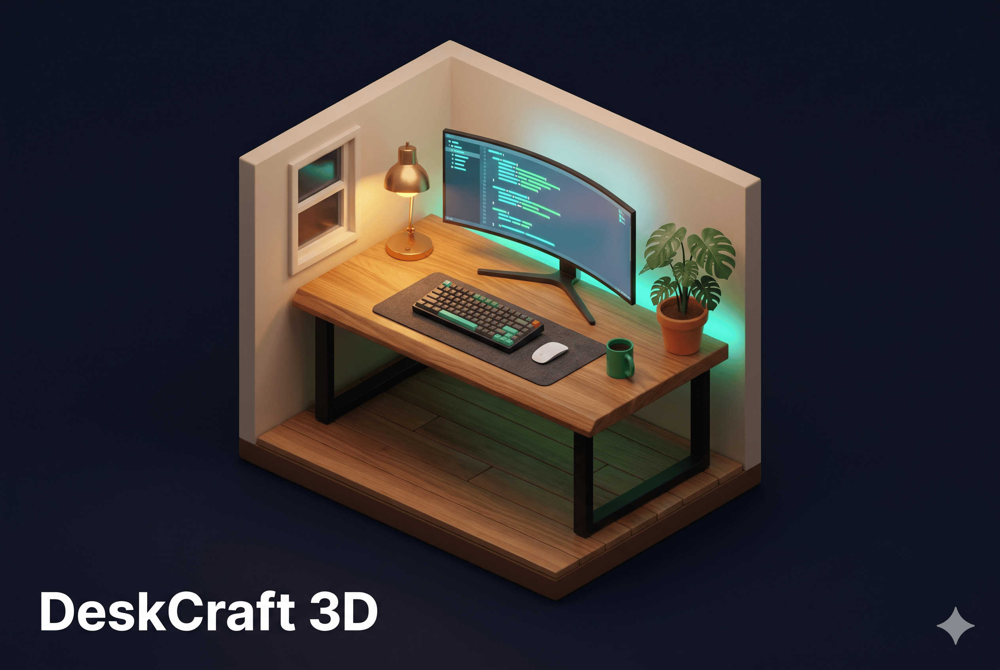
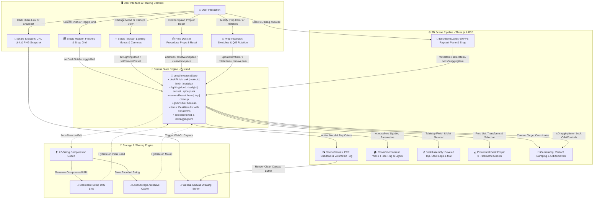

# DeskCraft 3D — Interactive Cozy Workspace Configurator

<div align="center">

  

  <br />
  <br />

  [](https://nextjs.org/)
  [](https://react.dev/)
  [](https://threejs.org/)
  [](https://docs.pmnd.rs/react-three-fiber)
  [](https://www.typescriptlang.org/)
  [](https://tailwindcss.com/)
  [](https://zustand.docs.pmnd.rs/)
  [](https://developer.mozilla.org/docs/Web/Progressive_web_apps)
  [](./LICENSE)

  <p align="center">
    <strong>An interactive, zero-backend 3D workspace configurator and installable Progressive Web App (PWA).</strong><br />
    Design, customize, light, and share your dream developer or creative desk setup directly in your browser at a smooth 60 FPS.
  </p>

  <p align="center">
    Built for the <strong>Build Your Own Website Hackathon</strong> by Roxten Studios.
  </p>

</div>

---

## 📑 Table of Contents

- [Overview](#-overview)
- [Key Features](#-key-features)
- [Application Flow Architecture](#-application-flow-architecture)
- [Controls & Shortcuts](#-controls--shortcuts)
- [Tech Stack](#-tech-stack)
- [Project Structure](#-project-structure)
- [Getting Started](#-getting-started)
- [Procedural Design Philosophy](#-procedural-design-philosophy)
- [Disclosures & Credits](#-disclosures--credits)

---

## 🌟 Overview

**DeskCraft 3D** is a web-based spatial studio for assembling personal workspace environments. Built on **Next.js 16**, **React 19**, and **Three.js** (via `@react-three/fiber` and `@react-three/drei`), the app provides tactile direct-manipulation controls to configure furniture, tech peripherals, lighting atmospheres, and camera angles with sub-second load times and zero backend database dependencies.

Every model in DeskCraft 3D is **100% procedurally modeled in code** using Three.js geometric primitives and custom materials—requiring zero external `.glb` or `.hdr` asset downloads.

---

## ✨ Key Features

### 🛋️ 1. 3D Room Diorama & Ergonomic Desk
- **Architectural Room Shell:** Procedural room envelope with corner walls, baseboards, floorboards, woven geometric rug, and a backlit architectural window.
- **Parametric Desk Assembly:** Chamfered bevel-edge wooden tabletop, dual steel T-frame legs with crossbar, under-desk cable management tray, and a protective felt desk mat.
- **4 Premium Desk Finishes:**
  - 🪵 **Warm Oak:** Natural golden wood grain with dark slate mat and carbon legs.
  - 🌰 **Dark Walnut:** Deep rich brown hardwood with navy slate mat and obsidian legs.
  - 🌲 **Nordic Birch:** Light minimalist pale wood with ash mat and arctic white legs.
  - 🖤 **Matte Carbon:** Stealth dark composite with charcoal mat and emerald-accented steel legs.

### ⌨️ 2. Procedural 3D Desk Props
Choose from 8 procedural props available in the bottom dock:
- **🖥️ Ultrawide 34" Monitor:** Curved display with emissive code editor syntax bars, angled stand, and cable grommet.
- **⌨️ 75% Mechanical Keyboard:** Stepped mechanical keycaps, accent enter/spacebar, and angled ergonomic chassis.
- **🖱️ Pro Mouse:** Ergonomic contour shape with click split, metallic scroll wheel, and PTFE glide pads.
- **💡 Articulated Desk Lamp:** Multi-jointed cantilever boom arm with warm point spotlight cone.
- **🔊 Studio Monitor Speaker:** Dual cone acoustic drivers with sound baffle housing.
- **🪴 Ceramic Monstera Plant:** Organic leafy foliage inside a ceramic terracotta pot.
- **☕ Coffee Mug:** Glazed ceramic mug with beverage fill and side handle.
- **📓 Dot Grid Journal:** Hardcover journal with bookmark ribbon and precision stylus.

### 🎯 3. Tactile 3D Manipulation & Raycast Tracking
- **Invisible Raycast Plane:** Smooth 60 FPS surface tracking directly on the desk plane.
- **Auto Orbit Lock:** Automatically disables camera `OrbitControls` while dragging items, preventing erratic viewport drift.
- **Boundary Clamping:** Intelligently clamps props within the desk perimeter (`clampToDesk`).
- **Snap-to-Grid Mode:** Optional toggleable `0.08m` snap grid for millimeter-perfect alignment.
- **6 Color Customization Swatches:** Personalize any selected prop with `Obsidian`, `Arctic`, `Emerald`, `Amber`, `Terracotta`, or `Cobalt`.
- **Duplicate & Remove:** Clone setups or clear individual pieces with a single click.

### 💡 4. Atmospheric Studio Lighting Moods
Seamlessly cycle between 3 studio atmospheres that dynamically update key lights, rim lights, window glow, ambient fills, and distance fog:
- ☀️ **Morning Daylight:** Crisp, clean natural morning sunshine through the window with soft neutral shadows.
- 🌇 **Sunset Lo-Fi:** Warm amber side lighting with soft purple dusk fog and cozy golden-hour tones.
- ⚡ **Cyberpunk Neon:** High-contrast dual cyan/magenta rim lighting with moody dark ambient accents.

### 🎥 5. Cinematic Damped Camera Presets
Smooth vector interpolation (`THREE.Vector3.lerp`) transitions between three dedicated camera angles:
- 📸 **Hero View:** The iconic 45° isometric studio perspective showcasing the entire room diorama.
- 📐 **Top Grid View:** Orthographic top-down vantage point ideal for organizing desk clutter and spacing.
- 🔍 **Close-Up View:** Tactile eye-level depth-of-field view centered directly on keyboard and monitor.

### 🔗 6. Zero-Backend State Sharing & Local Autosave
- **URL Query Serialization:** Compresses the full workspace state (desk finish, lighting mood, camera, grid, and all prop coordinates/rotations/colors) into a compact `?setup=` URL query parameter using `lz-string`.
- **Instant Sharing:** Share your custom desk setup with anyone via a single link—no signups or database servers required.
- **Local Autosave:** Automatically persists your active build into `localStorage` (`deskcraft-3d-autosave-v2`) and restores it upon reload.

### 📸 7. High-Resolution PNG Snapshot Export
- Instantly capture high-res snapshots straight from the WebGL buffer (`gl.preserveDrawingBuffer: true`) with clean lighting and background fog preserved.

### 📱 8. Progressive Web App (PWA)
- Installable on macOS, Windows, iOS, and Android.
- Dynamic PWA icon routes (`app/pwa-icon/[size]`), native `manifest.ts`, and offline-ready service worker (`public/sw.js`).

---

## 🔄 Application Flow Architecture

The diagram below outlines the full lifecycle of DeskCraft 3D—from user interaction and state orchestration in Zustand to Three.js scene rendering and zero-database URL serialization:



---

## 🎮 Controls & Shortcuts

| Action | Control / Keybinding | Description |
| :--- | :--- | :--- |
| **Move Prop** | <kbd>Left Click + Drag</kbd> | Drag any prop across the desk with surface snapping |
| **Orbit Camera** | <kbd>Left Click + Drag</kbd> (Empty Space) | Rotate 3D studio camera around the room |
| **Pan Camera** | <kbd>Right Click + Drag</kbd> or <kbd>Two-Finger Drag</kbd> | Pan the viewport across the diorama |
| **Zoom View** | <kbd>Mouse Scroll</kbd> or <kbd>Pinch</kbd> | Smoothly zoom in and out of the workspace |
| **Rotate Selected Prop** | <kbd>Q</kbd> / <kbd>E</kbd> or <kbd>R</kbd> | Rotate the selected item by **45°** |
| **Delete Selected Prop** | <kbd>Delete</kbd> or <kbd>Backspace</kbd> | Remove the active prop from the desk |
| **Deselect Prop** | <kbd>Escape</kbd> or Click Empty Space | Clear the active prop selection |
| **Snap Alignment** | Click <kbd>Grid</kbd> button in header | Toggle `0.08m` snap-to-grid mode |

---

## 🛠️ Tech Stack

| Category | Technology | Version | Purpose |
| :--- | :--- | :--- | :--- |
| **Framework** | [Next.js (App Router)](https://nextjs.org/) | `16.4.6` | React framework with Turbopack, App Router & PWA routing |
| **UI Library** | [React](https://react.dev/) | `19.3.0` | Declarative UI component architecture |
| **3D Rendering** | [Three.js](https://threejs.org/) | `^0.187.0` | WebGL 3D graphics rendering engine |
| **React 3D Bridge**| [@react-three/fiber](https://docs.pmnd.rs/react-three-fiber) | `^9.8.2` | Declarative Three.js scene graph in React |
| **3D Helpers** | [@react-three/drei](https://github.com/pmndrs/drei) | `^10.7.9` | Camera controls (`OrbitControls`), shadows, and canvas utilities |
| **State Management**| [Zustand](https://zustand.docs.pmnd.rs/) | `^5.1.0` | Lightweight reactive global store for workspace state |
| **Compression** | [lz-string](https://github.com/pieroxy/lz-string) | `^1.5.0` | Fast URL-safe compression for zero-database state sharing |
| **Styling** | [Tailwind CSS](https://tailwindcss.com/) | `v4.3.3` | Modern utility-first CSS styling with backdrop blur |
| **Icons** | [Lucide React](https://lucide.dev/) | `^1.78.0` | Clean, accessible vector UI icons |
| **Language** | [TypeScript](https://www.typescriptlang.org/) | `^5.0.0` | Strict type safety across all components and 3D props |

---

## 📁 Project Structure

```text
deskcraft-3d/
├── public/
│   ├── deskcraft-thumbnail.png    # Preview thumbnail
│   ├── sw.js                      # Offline Progressive Web App Service Worker
│   └── ...                        # Static icons and assets
├── src/
│   ├── app/
│   │   ├── favicon.ico
│   │   ├── globals.css            # Tailwind CSS v4 design system
│   │   ├── layout.tsx             # Root layout with PWA meta & theme
│   │   ├── manifest.ts            # Dynamic Web App Manifest
│   │   ├── page.tsx               # Main Studio Canvas & HUD container
│   │   └── pwa-icon/              # Dynamic PNG icon generation via next/og
│   ├── components/
│   │   ├── canvas/
│   │   │   ├── CameraRig.tsx          # Damped camera preset transitions & OrbitControls
│   │   │   ├── DeskAssembly.tsx       # Parametric desk top, steel legs, mat & wire tray
│   │   │   ├── DeskItemsLayer.tsx     # Raycast plane hit tracking, drag & drop, shortcuts
│   │   │   ├── DeskPropModel.tsx      # 8 procedural 3D model definitions & materials
│   │   │   ├── RoomEnvironment.tsx    # Walls, floorboards, window glow & lighting rigs
│   │   │   └── SceneCanvas.tsx        # Canvas wrapper with shadows, fog & background
│   │   └── ui/
│   │       ├── ItemDock.tsx           # Bottom prop spawning shelf & reset buttons
│   │       ├── ItemInspector.tsx      # Prop inspector: swatches, rotation, clone, delete
│   │       ├── PwaManager.tsx         # PWA installation banner & service worker register
│   │       ├── ShareExportControls.tsx# LZ-string URL share & WebGL PNG snapshot export
│   │       └── StudioToolbar.tsx      # Lighting mood & camera angle switcher
│   ├── lib/
│   │   └── workspaceShare.ts      # LZ-String codec, validation, sanitization & export
│   ├── store/
│   │   └── useWorkspaceStore.ts   # Central Zustand store (items, finish, mood, camera)
│   └── types/
│       └── workspace.ts           # TypeScript interfaces, catalogs & color palettes
├── package.json
└── README.md
```

---

## 🚀 Getting Started

Follow these steps to run the project locally on your machine:

### Prerequisites
- [Node.js](https://nodejs.org/) (version `18.17.0` or higher recommended)
- `npm`, `pnpm`, or `yarn`

### 1. Clone the repository
```bash
git clone https://github.com/prabhattopi/deskcraft-3d.git
cd deskcraft-3d
```

### 2. Install dependencies
```bash
npm install
```

### 3. Start development server
```bash
npm run dev
```

Open [http://localhost:3000](http://localhost:3000) in your browser to start configuring your 3D workspace.

### 4. Build for production
```bash
npm run build
npm run start
```

---

## 💡 Procedural Design Philosophy

1. **Zero External Assets:** Traditional 3D web apps require downloading multi-megabyte `.gltf` or `.glb` files and heavy HDR environment textures, which results in slow initial page loads. DeskCraft 3D crafts every piece of geometry—from the curved monitor bezels and keycaps to the monstera leaves—purely through code with Three.js primitives (`BoxGeometry`, `CylinderGeometry`, `ExtrudeGeometry`, and `MeshStandardMaterial`).
2. **Instant Sub-Second Boot:** Because there are no remote 3D models or HDRIs to download over the network, the 3D diorama renders immediately on load.
3. **Infinite Customization:** Every dimension, bevel, roughness, emissive intensity, and color tone can be updated in real time via React state without re-baking textures.

---

## 📄 Disclosures & Credits

- **Open Source Libraries:** Built with open-source packages including `next`, `react`, `three`, `@react-three/fiber`, `@react-three/drei`, `zustand`, `lz-string`, and `lucide-react`.
- **Hackathon Entry:** Developed for the **Build Your Own Website Hackathon** organized by Roxten Studios.
- **AI Assistance Disclosure:** AI coding tools were utilized during development for architecture brainstorming, TypeScript typing, and documentation refinement.

---

<div align="center">
  <sub>Crafted with passion for cozy developer and creative workspaces. ✨</sub>
</div>
